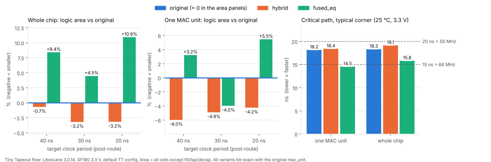

# MAC units for a 2x2 int8 systolic array on Tiny Tapeout

Two drop-in replacements for the MAC unit of
[tt_um_essen](https://github.com/Essenceia/Systolic_MAC_with_DFT),
a 2x2 int8 systolic array by Julia Desmazes, taped out on Tiny Tapeout (GF180).

- **hybrid** is smaller: one MAC unit is 4-6% smaller, the whole chip is up to 3.2% smaller.
- **fused_eq** is faster: the critical path is 20% shorter for one unit and 14% shorter for the whole chip.

Both units have the same ports, registers and latency as the original.
The results are bit-exact.
All numbers come from the standard Tiny Tapeout flow (LibreLane) run in GitHub Actions.

The full description is in the [report](https://arxiv.org/abs/2610.24326).

## What a MAC unit does

A MAC (multiply-accumulate) unit computes `r = clamp(a * w + c)`.
All numbers are int8, that is, signed 8-bit numbers from -128 to 127.
`clamp` is saturation: a result that does not fit in int8 becomes 127 or -128.
For example, `10 * 10 + 50 = 150` gives `r = 127`.

## Results

Logic area after place and route, in µm², and the change against the original.

| Level | Variant | 40 ns | 30 ns | 20 ns |
|---|---|---|---|---|
| One unit | original | 16 170 | 17 221 | 17 105 |
| | hybrid | 15 204 (-6.0%) | 16 378 (-4.9%) | 16 381 (-4.2%) |
| | fused_eq | 16 695 (+3.2%) | 16 539 (-4.0%) | 18 042 (+5.5%) |
| Whole chip | original | 68 124 | 71 210 | 71 089 |
| | hybrid | 67 656 (-0.7%) | 68 940 (-3.2%) | 68 839 (-3.2%) |
| | fused_eq | 73 860 (+8.4%) | 74 400 (+4.5%) | 78 863 (+10.9%) |

Critical path at the typical corner (25 °C, 3.3 V), 20 ns run.

| Level | original | hybrid | fused_eq |
|---|---|---|---|
| One unit | 18.2 ns | 18.4 ns | 14.5 ns (-20%) |
| Whole chip | 18.3 ns | 19.1 ns | 15.8 ns (-14%) |



Why the gain for the whole chip is small: the arithmetic is only about 45% of the chip,
and the top row of the array gets a constant 0, so the tools already simplify it.
Section 6 of the report explains this in detail.

## The two units in short

**hybrid.** The top row of the array always gets `c = 0`. The other rows get any `c`.
The best structure is different for these two cases, so hybrid has a parameter `TOP_ROW`:
- `TOP_ROW = 1` (top row): the product is limited to 9 bits, then a short 10-bit adder.
  9 bits are enough: if `|a * w| >= 256`, the result saturates for any `c`.
- `TOP_ROW = 0` (other rows): the four Booth partial products and `c` go into one adder tree.

hybrid needs one changed line in Julia's `mac.v`:
`mac_unit #(.W(W), .TOP_ROW(y == 0))`. The changed file is in `variants/extra/hybrid/`.

**fused_eq.** `c` is added inside the multiplier tree. The tree gives two numbers X and Y
with `X + Y = a * w + c`. The long sum `X + Y` is never computed.
An 8-bit adder gives the low bits, and a bitwise check tells if the sum fits in int8.
There is no long carry chain, so the unit is faster.

**One visible difference.** JTAG debug address 3 returned the upper byte of the 16-bit sum.
The new units do not build this sum, so address 3 returns the saturation flags.
Addresses 0 to 2 and all results are the same.

## Use the units in your design

hybrid:
1. Copy `variants/mac_unit_hybrid.v` to `src/mac_unit.v` of the original project.
2. Copy `variants/extra/hybrid/mac.v` to `src/mac.v`.

fused_eq:
1. Copy `variants/mac_unit_fused_eq.v` to `src/mac_unit.v`.

All other files of the original project stay as they are
(the units still use Julia's `booth_radix4_enc.v`).

## How correctness was checked

Every variant passed three checks. They test different things.

1. **Exhaustive simulation** (Icarus Verilog): all 2^24 inputs `(a, w, c)` of one unit.
   The original and all variants run side by side and must give the same `r`.
2. **Formal equivalence** (Yosys `equiv_make`, `equiv_simple`, `equiv_induct`):
   a proof that the logic between the registers is the same for every register value.
3. **The original test bench** (7 cocotb tests): the unit inside the whole chip,
   with the control logic, the data flow and JTAG.

Run them yourself (needs `iverilog`, `yosys`, `pip install cocotb==2.0.1 pytest`):

```bash
bash scripts/verify.sh           # all checks, about 30 min
bash scripts/verify.sh --quick   # without checks 1 and 2, about 1 min
```

## Reproduce the measurements

You only need a GitHub account. The heavy work runs on GitHub's machines.

1. Fork this repository (make your own copy on GitHub).
2. Open the **Actions** tab, choose **sweep**, press **Run workflow**.
3. Choose the levels (`single`, `full`), the variants and the clock periods in ns.
4. GitHub runs one job per point. Each job downloads the original design at a fixed commit,
   puts in the variant, sets the clock period and runs the standard Tiny Tapeout hardening.
5. The last job builds the tables, a CSV file and the charts. Download them as the artifact `report`.

Two levels:
- `single`: one MAC unit alone on a 1x1 tile. The difference between variants is the difference of the arithmetic.
- `full`: the whole `tt_um_essen` chip on 2 tiles, with only `mac_unit.v` replaced.

The flow is deterministic: two separate sweeps gave the same numbers to the last digit.

### Quick synthesis on your own computer

`scripts/synth_local.py` runs only the synthesis step of LibreLane, with the same script
and settings, in a few seconds and without Docker.
Its synthesis area matches the full flow within 0.1 µm² on the `single` level.

```bash
pip install librelane==3.0.14 pyosys==0.60
bash scripts/get_gf180_lib.sh                 # downloads the GF180 cell library
python3 scripts/synth_local.py single hybrid --period 20
```

## Test your own block

- New MAC unit: add `variants/mac_unit_<name>.v` and give `<name>` in the list of variants.
- Another Tiny Tapeout project: change the repository and commit in `versions.env`,
  and the replaced file in `scripts/prepare.sh`.

## Repository structure

| Folder or file | What it does |
|---|---|
| `variants/` | One file `mac_unit_<name>.v` per variant |
| `variants/extra/` | Other changed files of a variant (hybrid: `mac.v`) |
| `bench_single/` | A small wrapper that puts one MAC unit on a 1x1 tile |
| `verify/` | Test benches and the formal proof script |
| `scripts/verify.sh` | Runs all correctness checks |
| `scripts/prepare.sh` | Builds one project: original design + one variant + one clock period |
| `scripts/run_one.sh` | Runs `prepare.sh`, then the LibreLane flow, then collects the numbers |
| `scripts/collect_one.py` | Takes the numbers of one run from the LibreLane output |
| `scripts/report.py` | Makes the tables, the CSV file and the charts from all runs |
| `scripts/synth_local.py` | Runs only the synthesis step of LibreLane, without Docker |
| `tools/` | Truth-table generator used for the `table` variant |
| `.github/workflows/sweep.yaml` | The experiment: levels x variants x clock periods |
| `.github/workflows/checks.yaml` | Quick checks on every push |
| `versions.env` | Fixed versions of everything |
| `paper/` | The report (LaTeX source and PDF) |

## Fixed versions

| Item | Version |
|---|---|
| Original design | `Essenceia/Systolic_MAC_with_DFT`, commit `6a3c04e` |
| Tiny Tapeout tools | `tt-support-tools`, commit `01d5d28` |
| Flow | LibreLane 3.0.14 |
| Process | GF180MCU D, cell library `gf180mcu_fd_sc_mcu7t5v0`, 3.3 V |

## License

Apache-2.0, the same as the original design.
The variants are based on `mac_unit.v` and `booth_radix4_mul.v` by Julia Desmazes.

## Citation

If you use this work, please cite the report:

```
D. Gorodecky, “MAC units for a 2x2 int8 systolic array on Tiny Tapeout” // arXiv: 10.48550 [cs.AR]. DOI: 10.48550/arXiv.2610.24326
```

## Author

Danila Gorodecky (Gorodetsky), INESC-ID, Lisbon, Portugal

danila.gorodecky@gmail.com
